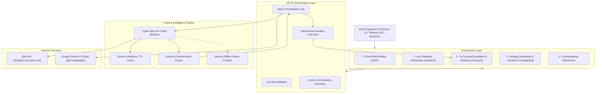

# Culture Radar 🧭

> **AI-Powered Cultural Intelligence & Event Strategy Agent**  
> Built for the **Qloo Agentic Hackathon 2026**

Culture Radar is an autonomous event strategy agent that transforms abstract audience descriptions, anchor tastes, and geographic context into evidence-grounded, culturally coherent event concepts and actionable production strategies using **Qloo's Cultural Intelligence API** and **Google Gemini** (`@ai-sdk/google`).

---

## 🌟 The Core Innovation

Event planners typically rely on demographic stereotypes or intuition when selecting performers, sponsors, and food & beverage concepts. Generic LLMs exacerbate this by recommending mainstream clichés (e.g. generic Top-40 pop and mass-market energy drinks).

**Culture Radar solves this with empirical cultural intelligence:**
1. **Qloo API Grounding:** Resolves anchor artists and brands via `/search`, then uncovers non-obvious cross-category taste affinities across Artists (`urn:entity:artist`), Brand Sponsors (`urn:entity:brand`), and Venues/F&B (`urn:entity:place`) using `/v2/insights`.
2. **Deterministic Budgeting:** An exact code-enforced financial engine guaranteeing **100% budget balance** across 7 production pillars—completely preventing AI hallucinated math.
3. **Traceable Evidence Registry:** Every material recommendation links to a verified Qloo evidence record with affinity match percentages, source queries, and data limitations.
4. **Baseline Benchmark Mode:** Direct side-by-side comparison between Culture Radar (Qloo-enabled) and a conventional LLM baseline (demographic guessing), visibly demonstrating that cultural intelligence materially alters strategic decisions.
5. **Conversational Refinement:** Interactive natural-language adjustments (e.g. *"Reduce budget by 20%"*, *"Shift focus to live music"*) with real-time deterministic rebalancing.

---

## 🏗️ Architecture



---

## 📡 Qloo API Integration Specifics

In accordance with official documentation (`https://docs.qloo.com/reference/api-overview`):
- **Base URL:** `https://hackathon.api.qloo.com` (configurable via `QLOO_BASE_URL`).
- **Authentication:** `X-Api-Key` HTTP header on all GET requests.
- **Endpoints Utilized:**
  - `GET /search`: Resolves user anchor artists and brands to validated Qloo entity UUIDs.
  - `GET /v2/insights`: Queries taste affinities with `filter.type` (`urn:entity:artist`, `urn:entity:brand`, `urn:entity:place`), `signal.interests.entities`, and `bias.trends=medium`.
  - `GET /v2/tags`: Queries taste taxonomy tags.
- **Resilience Policy:**
  - Automatic exponential backoff retry on HTTP 429 rate limits.
  - Graceful fallback: If an API key is missing or an endpoint returns no matches, authentic fallback fixtures are used and labeled with `qloo_mock_fixture` provenance to prevent synthetic hallucinations.

---

## 🚀 Quick Start

### 1. Prerequisites
- Node.js v20+ or v24+
- npm v10+

### 2. Installation
```bash
git clone https://github.com/your-username/cultural-radar.git
cd "cultural-radar"
npm install
```

### 3. Environment Variables
Copy `.env.example` to `.env.local` and add your keys:
```bash
cp .env.example .env.local
```

Edit `.env.local`:
```env
# Qloo Hackathon API Key (works against https://hackathon.api.qloo.com)
QLOO_API_KEY=your_qloo_hackathon_api_key_here
QLOO_BASE_URL=https://hackathon.api.qloo.com

# Google Gemini API Key
GOOGLE_GENERATIVE_AI_API_KEY=your_gemini_api_key_here
GEMINI_MODEL=gemini-2.0-flash

# Set to true to test with authentic mock fixtures without live keys
USE_MOCK_FALLBACK=false
```

### 4. Running Locally
```bash
npm run dev
```
Open [http://localhost:3000](http://localhost:3000) in your browser.

### 5. Running Automated Tests
```bash
npm test
```
Runs the full Vitest suite covering:
- Resilient Qloo API Client & TTL Caching
- Deterministic Budget Calculator (100% balance across arbitrary odd budgets)
- End-to-end Agent Orchestrator & Evidence Normalization

### 6. Production Build
```bash
npm run build
npm start
```

---

## 📊 Core Screens & User Journey

1. **Showcase Landing (`/`)**: Overview with value pillars and 1-click exploration of pre-seeded briefs (*Dubai: Symphony & Spice*, *Brooklyn: Neo-Acoustic Sessions*, *Tokyo: Spatial Sound Summit*).
2. **Event Brief Builder (`/brief`)**: Form for venue, audience psychographics, budget constraints, and anchor entities.
3. **Agent Research Workspace (`/research`)**: Live 5-stage telemetry cards, progress indicators, and real-time execution log.
4. **Concept Evaluation (`/concepts`)**: Tri-concept cards with deterministic budget progress bars, evidence links, and the **Baseline vs. Culture Radar** comparison mode.
5. **Strategy Dashboard (`/strategy/[id]`)**: Executive summary, Recharts Budget Donut, Recharts Cultural Affinity Radar, experiential programming, 4-phase production timeline, operational risk matrix, and natural-language conversational refinement.
6. **Print to PDF**: Built-in print stylesheet for instant client report export.

---

## ⚖️ License
MIT License. Built for the Qloo Agentic Hackathon 2026.
